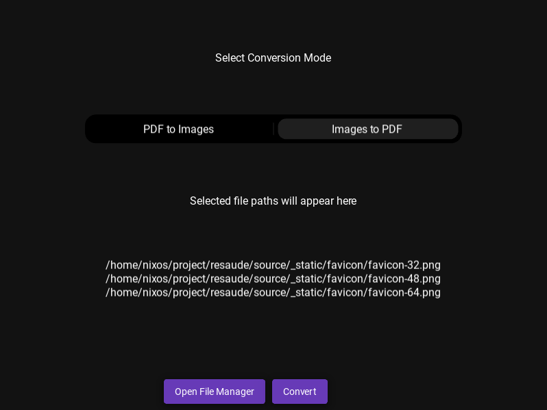
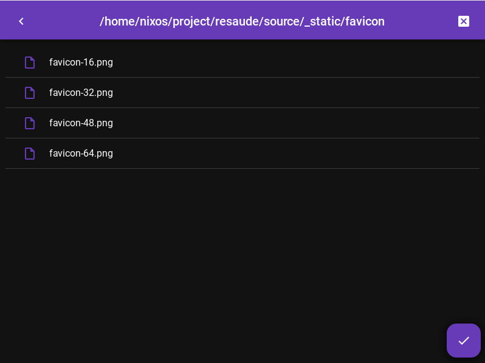

[](https://github.com/pre-commit/pre-commit)
[](https://github.com/astral-sh/ruff)
[](https://github.com/PyCQA/bandit)
[](https://mypy-lang.org/)

A GUI for the pdf-img-converter




## Prerequisites

- Python 3.12+
- [PDM](https://pdm-project.org/) for dependency management
- [Just](https://github.com/casey/just) for task automation (optional but recommended)
- [direnv](https://direnv.net/) for automatic environment activation (optional but recommended)

## Installation

### From PyPI (when published)
```bash
pip install pdf-img-converter-gui
```

### From Git repository
```bash
pip install git+https://github.com/cdubos-fr/pdf-img-converter-gui
```

### In editable mode for development
```bash
pip install -e .
```

## Development Setup

### Automatic setup with direnv (recommended)

If you have [direnv](https://direnv.net/) installed:

1. Clone the repository
2. `cd` into the project directory
3. Run `direnv allow` when prompted
4. The environment will be automatically set up and activated

### Manual setup

1. Install PDM if not already installed:
   ```bash
   pip install pdm
   ```

2. Create and activate the development environment:
   ```bash
   just devenv
   # or manually:
   pdm lock
   tox devenv -e devenv .venv
   source .venv/bin/activate
   pre-commit install
   ```

## Available Commands

With [Just](https://github.com/casey/just) installed:

```bash
# Set up development environment
just devenv

# Run tests
just test

# Run type checking
just typecheck

# Format code
just format

# Lint code
just lint

# Serve documentation locally
just serve-docs

# Clean build artifacts
just clean
```

Or use the underlying tools directly:

```bash
# Run tests
tox -e tests
# or
pdm run pytest

# Type checking
tox -e typing
# or
pdm run mypy

# Build package
pdm build
```

## Running the Application

After installation:

```bash
pdf-img-converter-gui
```

Or in development mode:

```bash
pdm run python -m pdf_img_converter_gui.app
```
